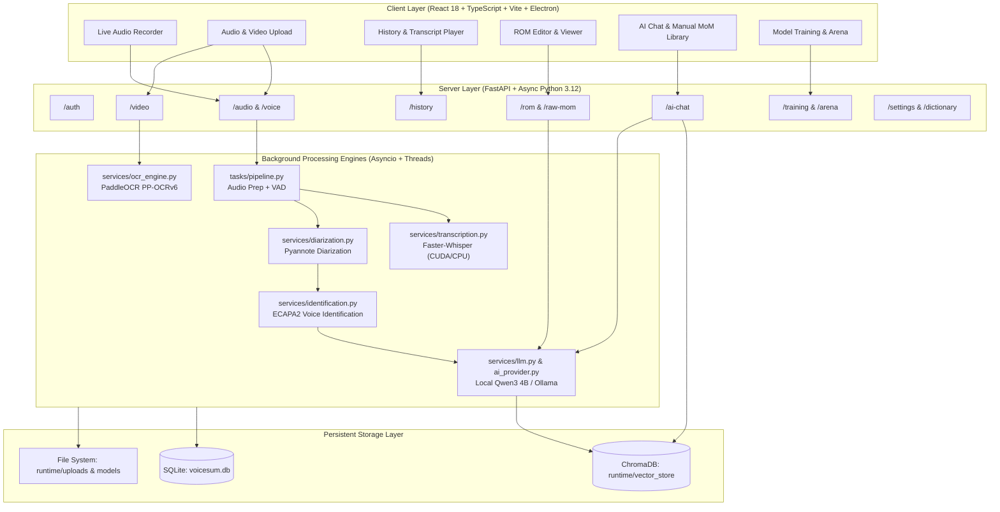

# VoiceSum / AI Meeting Transcriber — System Overview & Architecture

## 1. Executive Summary

**VoiceSum** is an enterprise-grade, 100% offline-capable, air-gapped meeting intelligence and transcription platform. The platform converts raw multi-speaker audio and video recordings into highly structured meeting intelligence, featuring:

- **Local Speech-to-Text**: Sub-word synchronized transcription using Faster-Whisper.
- **Local Speaker Diarization & Identification**: Pyannote.audio diarization combined with SpeechBrain ECAPA2 voice embedding profile matching.
- **Record of Meeting (ROM) Architecture**: Hierarchical meeting records structured into Short ROM, Medium ROM, and Long ROM with verified source citations, timeline timestamps, and agenda segmentation.
- **Offline Large Language Model Intelligence**: Powered by quantized local Qwen3-4B-Instruct models (with optional Ollama fallback) for summaries, action items, key decisions, and speaker contributions.
- **Multi-Vector Semantic Retrieval & AI Chat**: Hybrid RAG powered by local ChromaDB and Qwen3-Embedding-0.6B across Final ROM points, Meeting Slides, Context Documents, and Manual Minutes of Meeting (MoM).
- **Self-Contained Training & Model Arena**: On-premise fine-tuning (QLoRA adapters) and blind A/B model arena benchmarking.

---

## 2. High-Level System Architecture



---

## 3. Technology Stack

| Layer | Component | Technology | Rationale |
|---|---|---|---|
| **Desktop Client** | Shell Wrapper | Electron + Node.js | Cross-platform desktop runtime with native window management |
| **Frontend Web** | UI Framework | React 18, TypeScript, Vite | Zero-latency virtualized DOM, type safety, HMR |
| **Styling & Icons** | Design Tokens | Vanilla CSS Variables, Lucide React | High-performance glassmorphism, responsive themes, no build overhead |
| **Backend API** | Web Framework | FastAPI, Starlette, Uvicorn | High throughput ASGI, native async I/O, OpenAPI documentation |
| **Database** | Relational Store | SQLite (aiosqlite + SQLAlchemy Async) | Single-file embedded zero-config database, zero network overhead |
| **Vector Store** | Semantic Search | ChromaDB | Local on-disk persistent vector database for dense embeddings |
| **Speech-to-Text** | ASR Engine | Faster-Whisper (CTranslate2) | 4x faster than vanilla Whisper, low VRAM footprint |
| **Diarization** | Speaker Tracking | Pyannote.audio 3.1 | SOTA neural voice clustering and speaker segmentation |
| **Voice Identification**| Speaker Matching | SpeechBrain ECAPA2 | Deep cosine embedding comparison for speaker identity verification |
| **Local LLM** | NLP & Generation | Qwen3-4B-Instruct via PyTorch / CausalLM | Fast local reasoning, 32k context, structured JSON generation |
| **Embedding Model** | Dense Text Vectors | Qwen3-Embedding-0.6B | Lightweight, accurate semantic retrieval (1024 dimensions) |
| **OCR Engine** | Visual Slide Parser| PaddleOCR PP-OCRv6 (Offline) | Extract slide notes from video frames & uploaded PDFs |

---

## 4. Root Directory Structure

```
Transcriber-meeting-initial/
├── Application/                 # Packaged models, embeddings, runtime assets
│   └── runtime/
│       ├── embeddings/          # Local Qwen3-Embedding-0.6B weights
│       ├── models/              # Local Faster-Whisper, Pyannote, Qwen3 LLMs
│       └── ocr_models/          # PP-OCRv6 detection, recognition & classification
├── backend/                     # FastAPI core backend service
│   ├── checkpoints/             # QLoRA fine-tuned training checkpoints
│   ├── routers/                 # Modular API route controllers
│   ├── services/                # Business logic, ML models, vector stores
│   ├── tasks/                   # Long-running async pipeline tasks
│   ├── utils/                   # Audio conversion, file storage, security
│   ├── database.py              # Async SQLAlchemy connection & schema migrations
│   ├── config.py                # Centralized environment & directory paths
│   └── main.py                  # FastAPI application entrypoint
├── frontend/                    # React 18 TypeScript single-page application
│   ├── src/
│   │   ├── api/                 # Axios clients and API contract types
│   │   ├── components/          # Reusable UI widgets and modals
│   │   ├── features/            # Feature slices (ROM training, Collections)
│   │   ├── hooks/               # Custom hooks (polling, audio player, debounce)
│   │   ├── pages/               # Route views (Record, History, ROM, AIChat, etc.)
│   │   └── store/               # Zustand / reactive state managers
│   └── vite.config.ts           # Vite bundler configuration & dev server proxy
├── frontend-electron/           # Electron main process and preload scripts
├── tools/                       # Build scripts, PyInstaller spec, updater, patch builders
├── documentation/               # In-depth module documentation (this directory)
└── voicesum.db                  # Primary SQLite application database
```

---

## 5. End-to-End User Journeys

### Journey 1: Audio/Video Ingestion to Synchronized Transcript
1. User uploads an audio file (`.wav`, `.mp3`, `.m4a`) or video file (`.mp4`, `.mkv`) on `/dashboard/upload` or records live on `/dashboard/record`.
2. Backend receives file via `POST /audio/upload` or `POST /video/upload`.
3. Background task `run_pipeline` in `tasks/pipeline.py` begins:
   - Validates audio, runs RMS & Silero Voice Activity Detection (VAD).
   - Generates transcription segments via Faster-Whisper.
   - Extracts speaker diarization segments via Pyannote.
   - Matches speaker voice embeddings against enrolled voice profiles.
   - Produces synchronized word-level timestamps via WhisperX alignment.
4. Auto-generates initial Minutes of Meeting (MoM).
5. User navigates to `/dashboard/history/{id}` to play audio synchronously with highlight tracking.

### Journey 2: Record of Meeting (ROM) Generation and Editing
1. From History or Dashboard, user opens `/dashboard/history/{id}/rom`.
2. User triggers ROM generation via `POST /rom/{id}/generate`.
3. Backend segments transcript into distinct agendas, retrieves context from uploaded slides/documents, and invokes local Qwen3-4B.
4. Generates:
   - **Short ROM**: High-level takeaways, core decisions.
   - **Medium ROM**: Detailed discussion points grouped by agenda.
   - **Long ROM**: Granular factual points with explicit timeline stamps (`HH:MM:SS`) and speaker attribution.
5. User edits agendas, marks points verified, or clicks **Conclude Meeting** to finalize.

### Journey 3: AI Chat & Manual MoM Multi-Document Intelligence
1. User enters `/dashboard/chat`.
2. User can upload external manual MoM documents (`.pdf`, `.docx`, `.txt`) using the **Upload Manual MoM** modal.
3. System extracts text via PP-OCRv6, chunks content, generates 1024-dimension embeddings, and stores vectors in ChromaDB `final_rom_{user_id}`.
4. When the user asks a question, the backend queries across:
   - Manual MoM documents (Priority 1)
   - Final ROM discussion points (Priority 2)
   - Presentation slides / visual OCR (Priority 3)
   - Spoken transcript segments (Priority 4)
5. The local LLM synthesizes an answer with exact clickable citation chips.

---

## 6. Security and Offline Air-Gap Guarantee

- **Zero Cloud Leakage**: No audio, transcript, or document text is sent to external APIs (OpenAI, Anthropic, or external telemetry).
- **Embedded Inference**: All neural weights (Whisper, Pyannote, Qwen, PaddleOCR) run directly on local GPU (CUDA) or CPU via optimized CTranslate2 / PyTorch / ONNX runtimes.
- **Hardware-Locked Licensing**: `admin_license/license_validator.py` ensures tamper-proof node validation without requiring internet connectivity.
- **Atomic Local Persistence**: SQLite and ChromaDB write exclusively to the local application runtime folder.
