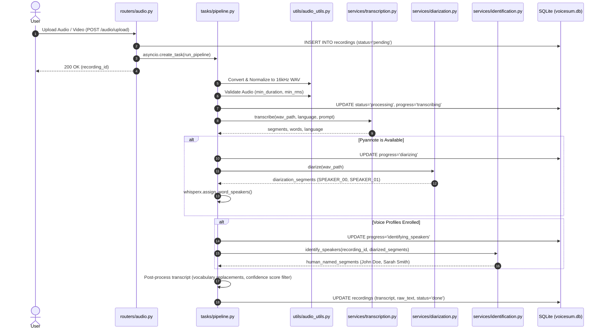

# Audio Ingestion, Transcription, and Diarization Pipeline

## 1. Overview & Architectural Role

The **Transcription & Diarization Pipeline** is responsible for transforming raw audio and video into word-accurate, speaker-attributed meeting transcripts. It runs asynchronously in background worker tasks and integrates five core technologies:

1. **Audio Pre-Processing & Voice Activity Detection (VAD)** (`utils/audio_utils.py`): Normalization, silence stripping, and multi-threshold speech recovery.
2. **ASR (Speech-to-Text)** (`services/transcription.py`): Faster-Whisper running on CTranslate2.
3. **Speaker Diarization** (`services/diarization.py`): Pyannote.audio neural clustering.
4. **Word-Level Alignment** (`whisperx` integration): Assigning exact timestamps and speaker labels to every spoken word.
5. **Voice Profile Identification** (`services/identification.py`): Matching audio signatures against enrolled user profiles using SpeechBrain ECAPA2.

---

## 2. End-to-End Pipeline Execution Flow



---

## 3. Detailed Component Breakdown & Code Sections

### 3.1 Audio Ingestion & Validation
- **Location:** [`backend/routers/audio.py`](file:///e:/projects/Transcriber-meeting-initial/backend/routers/audio.py) and [`backend/utils/audio_utils.py`](file:///e:/projects/Transcriber-meeting-initial/backend/utils/audio_utils.py)
- **Supported File Types:** `.wav`, `.mp3`, `.m4a`, `.ogg`, `.flac`, `.webm`, `.aac`, `.wma`.
- **Pre-Processing Steps:**
  1. **Conversion:** All audio is converted to single-channel 16,000 Hz 16-bit PCM WAV using FFmpeg:
     ```python
     # utils/audio_utils.py -> convert_to_wav()
     cmd = [
         "ffmpeg", "-y", "-i", input_path,
         "-vn", "-acodec", "pcm_s16le", "-ar", "16000", "-ac", "1", output_path
     ]
     ```
  2. **Energy / RMS Validation:** `validate_audio()` verifies that the audio is above minimum duration (default 2.0s) and minimum Root Mean Square amplitude (`min_rms=0.003`) to avoid processing pure silence or corrupted files.
  3. **Audio Normalization:** Peak normalization to `-3.0 dBFS` with adaptive dynamic range compression (`norm_compression_ratio=2.0`).

### 3.2 Long Audio Chunking Strategy
- **Location:** [`backend/tasks/upload_chunk_pipeline.py`](file:///e:/projects/Transcriber-meeting-initial/backend/tasks/upload_chunk_pipeline.py) and [`backend/tasks/chunk_pipeline.py`](file:///e:/projects/Transcriber-meeting-initial/backend/tasks/chunk_pipeline.py)
- **Threshold:** When recording duration exceeds `UPLOAD_CHUNK_THRESHOLD_SEC` (default 10 minutes):
  - Audio is split at natural silence points into parallel chunks of 10 minutes with a 15-second overlap window.
  - Workers transcribe segments in parallel.
  - Overlap de-duplication stitches words seamlessly using Levenshtein distance on timestamp borders.

### 3.3 ASR Transcription (Faster-Whisper)
- **Location:** [`backend/services/transcription.py`](file:///e:/projects/Transcriber-meeting-initial/backend/services/transcription.py)
- **Model:** Faster-Whisper (Large-v3 or Medium depending on GPU VRAM).
- **Inference Configuration:**
  - `compute_type`: `"float16"` on CUDA, `"int8"` or `"float32"` on CPU.
  - `beam_size`: 5.
  - `word_timestamps`: `True` (critical for phonetic word boundary alignment).
  - `vad_filter`: Integrated Silero VAD prevents Whisper hallucinations on non-speech segments.
  - `initial_prompt`: Dynamic dictionary builder (`services/prompt_builder.py`) injects user-defined vocabulary, jargon, acronyms, and speaker names into Whisper's conditioning context.

### 3.4 Neural Diarization (Pyannote 3.1)
- **Location:** [`backend/services/diarization.py`](file:///e:/projects/Transcriber-meeting-initial/backend/services/diarization.py)
- **Model:** `pyannote/speaker-diarization-3.1`.
- **Execution:**
  1. Computes acoustic voice embeddings over 2.0s sliding windows.
  2. Performs spectral clustering to isolate unique speakers (`SPEAKER_00`, `SPEAKER_01`, etc.).
  3. Identifies overlapping speech segments where multiple individuals speak simultaneously.

### 3.5 Word-Level Speaker Assignment (WhisperX Alignment)
- **Location:** [`backend/tasks/pipeline.py`](file:///e:/projects/Transcriber-meeting-initial/backend/tasks/pipeline.py) lines 350-450
- Bridges the ASR words and the Diarization timelines:
  1. Each word emitted by Whisper has an exact `start` and `end` millisecond timestamp.
  2. The pipeline maps word intervals onto Pyannote speaker segments using temporal intersection.
  3. Assigns the majority speaker label to each word and groups consecutive words into coherent conversational turns.

### 3.6 Voice Profile Identification (SpeechBrain ECAPA2)
- **Location:** [`backend/services/identification.py`](file:///e:/projects/Transcriber-meeting-initial/backend/services/identification.py)
- **Matching Methodology:**
  1. For each detected speaker (`SPEAKER_00`), extracts clean audio segments where only that speaker was active.
  2. Computes an ECAPA-TDNN 192-dimension or 512-dimension embedding vector for the speaker turn.
  3. Computes the cosine similarity against enrolled user voice profiles stored in SQLite (`speaker_profiles`):
     $$\text{Similarity}(u, v) = \frac{u \cdot v}{\|u\|_2 \|v\|_2}$$
  4. If $\text{Similarity} \ge \text{speaker\_similarity\_threshold}$ (default `0.75`), `SPEAKER_00` is renamed to the real identity (e.g. `"Dr. Robert Vance"`).
  5. If below threshold, retains anonymous label or allows manual user reassignment.

---

## 4. Re-running, Speaker Re-Identification & Editing

The pipeline provides non-destructive re-processing:
- **`POST /history/{id}/reidentify-speakers`**: Re-evaluates speaker voice embeddings with newly created voice profiles without repeating full ASR transcription.
- **`POST /history/{id}/rerun`**: Completely reruns transcription, diarization, and insights.
- **`PATCH /history/{id}/transcript`**: Allows frontend users to edit words or speaker assignments directly; updates the SQLite database immediately.
