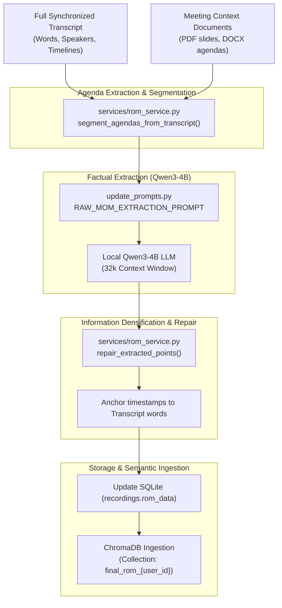

# Record of Meeting (ROM) System & Architecture

## 1. Overview & Concept

The **Record of Meeting (ROM)** system is the core intelligence framework of VoiceSum. Unlike conventional meeting minutes (which are typically unstructured text summaries that miss crucial details or hallucinate facts), the ROM architecture is a **grounded, multi-tiered, verifiable meeting record**.

Every single claim, statement, or decision extracted in a ROM is directly anchored to:
1. **Source Type**: Whether it came from the spoken `Transcript`, uploaded `Meeting Context` slides, or organizational `Global Context`.
2. **Timeline Anchor**: Exact millisecond start and end boundaries (`[HH:MM:SS - HH:MM:SS]`) in the audio/video.
3. **Speaker Attribution**: The individual speaker responsible for the statement.
4. **Information Density**: Factual numbers, dates, deadlines, and decisions are completely preserved without aggressive compression.

---

## 2. The Three ROM Tiers

```
┌────────────────────────────────────────────────────────────────────────┐
│                        ROM Multi-Tier Hierarchy                        │
├───────────────────┬────────────────────────────────────────────────────┤
│ Short ROM         │ High-level executive takeaways, top decisions, and │
│ (Strategic)       │ next critical milestones. Ideal for C-level view.  │
├───────────────────┼────────────────────────────────────────────────────┤
│ Medium ROM        │ Structured agenda-by-agenda breakdown with key     │
│ (Operational)     │ discussion points and explicit assigned actions.   │
├───────────────────┼────────────────────────────────────────────────────┤
│ Long ROM          │ Exhaustive factual record capturing all discussion │
│ (Comprehensive)   │ points, evidence citations, timelines, and facts.  │
└───────────────────┴────────────────────────────────────────────────────┘
```

---

## 3. Data Schema & Persistence

### 3.1 Database Representation
The ROM is stored in SQLite in two synchronized locations:
- **`recordings.rom_data`**: JSON string containing the active ROM tree.
- **`rom_metadata` Table**: Dedicated relational table storing historical versions and metadata:
  ```sql
  CREATE TABLE IF NOT EXISTS rom_metadata (
      id TEXT PRIMARY KEY,
      recording_id TEXT NOT NULL,
      user_id TEXT NOT NULL,
      rom_data TEXT NOT NULL,
      created_at TEXT NOT NULL,
      updated_at TEXT NOT NULL
  );
  ```

### 3.2 JSON Structure Schema
```json
{
  "meeting_info": {
    "title": "Quarterly Budget & Architecture Review",
    "date": "2026-10-08",
    "participants": ["Alice Chen", "Bob Davis", "Dr. Vance"]
  },
  "agendas": [
    {
      "agenda_id": "ag_01",
      "title": "Q3 Infrastructure Scaling & Budget",
      "discussion_points": [
        {
          "id": "ag_01_pt_0",
          "point": "Approved $45,000 budget increase for dedicated on-premise GPU clusters.",
          "type": "decision",
          "speaker": "Alice Chen",
          "source_type": "Transcript",
          "timeline": { "start": 342.5, "end": 380.2 },
          "source_reference": "00:05:42 - 00:06:20",
          "dates": [{ "value": "2026-11-01", "purpose": "Deployment deadline" }],
          "action": {
            "owner": "Bob Davis",
            "description": "Procure and rack-mount 4x RTX 6000 Ada GPUs",
            "deadline": "2026-10-31",
            "status": "open"
          }
        }
      ]
    }
  ],
  "action_items": [...],
  "decisions": [...],
  "summary": "..."
}
```

---

## 4. End-to-End ROM Generation Flow



---

## 5. Key Code Sections & API Routes

### 5.1 Backend Routes (`backend/routers/rom_router.py`)
- **`POST /rom/{recording_id}/generate`**: Triggers full pipeline generation. Accepts options:
  - `pipeline_mode`: `"base"` (standard Qwen3-4B) or `"trained"` (using QLoRA Stage 2/3 active variant adapter).
  - `source_types`: Choice of including spoken transcript, slides, or organizational context.
- **`GET /rom/{recording_id}`**: Retrieves complete structured ROM payload for frontend viewer.
- **`PUT /rom/{recording_id}`**: Persists user manual edits, updated agendas, reassigned points, or new action items.
- **`POST /rom/{recording_id}/conclude`**: Finalizes the ROM. Flags the meeting as concluded and automatically synchronizes all verified discussion points into the ChromaDB vector database.
- **`POST /rom/{recording_id}/resync`**: Synchronizes existing ROM points back to the user's vector collection if ChromaDB was cleaned or reconstructed.

### 5.2 Core Business Logic (`backend/services/rom_service.py`)
- **`generate_rom_for_recording(recording_id, user_id, ...)`**: Coordinates token budgeting, prompt construction, LLM streaming, and JSON repair.
- **`sync_final_rom_points_to_chroma(user_id, recording_id, rom_data)`**:
  - Iterates over all points in all agendas.
  - Generates 1024-dimension embeddings via `Qwen3-Embedding-0.6B`.
  - Ingests metadatas with keys: `meeting_id`, `agenda_title`, `speaker`, `timeline`, and `clean_text`.

---

## 6. Frontend ROM Workspace (`frontend/src/pages/RomPage.tsx`)

The frontend delivers an interactive command center:
1. **Interactive Timeline Scrubbing**: Clicking any point's `[HH:MM:SS]` timestamp jumps the audio/video player directly to that instant.
2. **Agenda Manager**: Users can reorder agendas via drag-and-drop, add new discussion topics, merge agendas, and delete irrelevant points.
3. **Point Verification**: Checkbox to toggle points as *Verified by Human*.
4. **Live Markdown & PDF Export**: Instant export to executive PDF or Word document with corporate branding.
