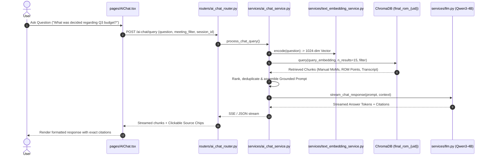

# AI Chat & Multi-Document Semantic Retrieval (RAG)

## 1. Overview & Architectural Role

The **AI Chat** subsystem allows users to converse naturally with their entire catalog of meetings, presentation slides, organizational knowledge bases, and externally uploaded Minutes of Meeting (MoMs).

It utilizes a **Hybrid Multi-Tier Retrieval-Augmented Generation (RAG)** pipeline that prioritizes verified high-density discussion points before falling back to raw spoken transcripts.

---

## 2. Multi-Tier Retrieval Hierarchy

When a user submits a query in AI Chat, the engine performs parallel vector search across distinct information tiers and merges the results according to priority:

```
┌────────────────────────────────────────────────────────────────────────┐
│                      RAG Priority Retrieval Tiers                      │
├────────────┬──────────────────┬────────────────────────────────────────┤
│ Priority 1 │ Manual MoM Docs  │ Uploaded .pdf, .docx, or .txt minutes. │
│            │ (Highest Trust)  │ User-verified human documentation.     │
├────────────┼──────────────────┼────────────────────────────────────────┤
│ Priority 2 │ Final ROM Points │ Structured, verified agenda points and │
│            │                  │ decisions from concluded meetings.     │
├────────────┼──────────────────┼────────────────────────────────────────┤
│ Priority 3 │ Meeting Context  │ Uploaded presentation slides, agendas, │
│            │ & Slides         │ and visual video OCR keyframes.        │
├────────────┼──────────────────┼────────────────────────────────────────┤
│ Priority 4 │ Raw Transcript   │ Raw word-for-word spoken transcript    │
│            │ Chunks           │ segments with start/end timestamps.    │
└────────────┴──────────────────┴────────────────────────────────────────┘
```

---

## 3. Retrieval Flowchart



---

## 4. Manual MoM Upload & Library Integration

Users can upload pre-existing meeting documents directly in AI Chat via the **Manual MoM Library Modal** (`frontend/src/components/ManualMomLibraryModal.tsx`).

### 4.1 Processing Flow (`services/manual_mom_service.py`)
1. User uploads a file (`.docx`, `.pdf`, `.txt`, `.md`, `.pptx`).
2. Server extracts text via `services/doc_extractor.py` (offline PP-OCRv6 for scanned docs/PDFs).
3. Metadata parser (`extract_metadata_and_sections()`) extracts meeting title, date, attendees, agendas, action items, and key decisions.
4. Chunker (`chunk_manual_mom()`) divides text into semantic paragraphs (max 400 tokens with 50-token overlap).
5. Embeds all chunks using `Qwen3-Embedding-0.6B`.
6. Ingests embeddings into ChromaDB collection `final_rom_{user_id}` with metadata tag `source="manual_mom"` and `is_manual_mom="true"`.
7. Persists document record in the **`manual_moms`** SQLite table.

### 4.2 Isolation from Audio Recordings
Manual MoMs are purely textual/document records and do not contain audio files or speech transcription data. Therefore:
- They are stored exclusively in the `manual_moms` table.
- They are **NOT** inserted into the `recordings` table.
- This ensures that audio-centric pages (such as `/dashboard/history`) only display actual audio/video recordings with playable media.

---

## 5. Citations & Grounding

Every answer produced by AI Chat contains metadata linking back to its sources:
- **`meeting_id`**: Identifier of the source meeting or manual MoM.
- **`meeting_name`**: Human-readable name.
- **`agenda_title`**: Relevant agenda section.
- **`timeline`**: `{"start": 124.5, "end": 158.0}`.
- **`source_reference`**: Timestamp display (`00:02:04 - 00:02:38`) or document filename (`Architecture_Notes.docx`).

Clicking a source chip in the chat interface navigates directly to the exact timestamp in History or opens the Manual MoM viewer modal.
