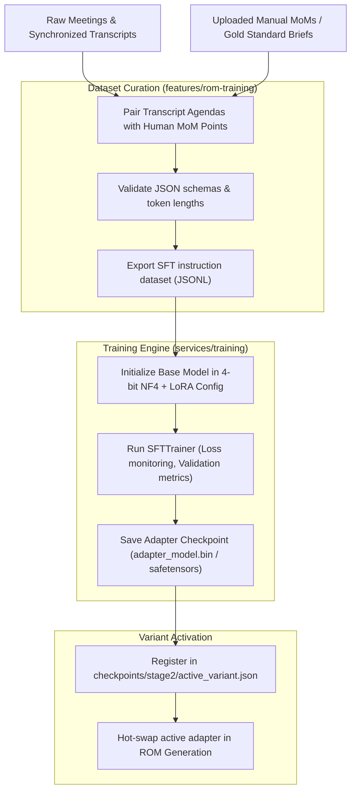

# Model Training, Fine-Tuning & Model Arena

## 1. Overview & Purpose

VoiceSum includes a fully self-contained, on-premise **Fine-Tuning & Adapter Training Subsystem**. This enables organizations to customize and adapt the local Qwen3-4B LLM to their specific:
- Organizational vernacular, acronyms, and technical terminology.
- Preferred meeting minutes formats and executive reporting styles.
- High-precision agenda segmentation and action point extraction.

All training is executed locally using **Parameter-Efficient Fine-Tuning (PEFT / QLoRA)**, allowing adaptation on consumer and workstation GPUs (e.g., RTX 3080/4080/4090, RTX 6000 Ada) without requiring multi-GPU cloud clusters.

---

## 2. Multi-Stage Training Framework

```
┌────────────────────────────────────────────────────────────────────────┐
│                   VoiceSum Multi-Stage Training Stages                 │
├─────────┬───────────────────┬──────────────────────────────────────────┤
│ Stage 1 │ Vocabulary &      │ Domain adaptation on company terms,      │
│         │ Terminology       │ acronyms, and product dictionaries.      │
├─────────┼───────────────────┼──────────────────────────────────────────┤
│ Stage 2 │ Agenda Extraction │ Supervised Fine-Tuning (SFT) on paired   │
│         │ & Discussion Pts  │ transcripts and verified ROM agendas.    │
├─────────┼───────────────────┼──────────────────────────────────────────┤
│ Stage 3 │ ROM Compression   │ Fine-tuning models to synthesize Long    │
│         │ & Synthesis       │ ROM points into concise Medium & Short   │
│         │                   │ executive briefs.                        │
└─────────┴───────────────────┴──────────────────────────────────────────┘
```

---

## 3. QLoRA Technical Specifications

- **Base Model:** `Qwen/Qwen3-4B-Instruct`
- **Quantization:** 4-bit NormalFloat (`bitsandbytes` NF4) with double quantization.
- **LoRA Configuration:**
  - Rank ($r$): 16 (or 32 depending on VRAM profile).
  - Alpha ($\alpha$): 32.
  - Dropout: 0.05.
  - Target Modules: `q_proj`, `k_proj`, `v_proj`, `o_proj`, `gate_proj`, `up_proj`, `down_proj`.
- **Training Algorithm:**
  - Hugging Face `SFTTrainer` with AdamW 8-bit optimizer.
  - Cosine learning rate schedule with linear warmup.
  - Gradient checkpointing enabled to minimize peak activation VRAM.

---

## 4. Training Workflow & Data Curation



---

## 5. Model Arena (`frontend/src/pages/ModelArena.tsx`)

The **Model Arena** provides an empirical, blind A/B evaluation suite inspired by LMSYS Chatbot Arena:

1. **Side-by-Side Inference:** Runs two model variants (e.g. `Base Qwen3-4B` vs `Variant_Sprint42_Adapter`, or `Prompt_Template_A` vs `Prompt_Template_B`) simultaneously on the identical meeting transcript.
2. **Blind Evaluation:** Model identities are masked as **Model A** and **Model B**.
3. **Voting System:** Reviewers rate:
   - *Model A is Better*
   - *Model B is Better*
   - *Tie / Both are Good*
   - *Both are Bad*
4. **Analytics & Elo Ratings:**
   - Computes win rates, accuracy metrics, and Elo leaderboard standings in SQLite (`arena_battles` table).
   - Prevents deploying inferior model checkpoints into production ROM generation.

---

## 6. Key Code References

- **`backend/routers/training_routes.py`**: Handles Stage 1, 2, and 3 dataset creation and training job submissions.
- **`backend/routers/rom_training_router.py`**: Specializes in ROM pairing, variant metadata registration, and adapter testing.
- **`backend/services/training/qlora_training_service.py`**: Encapsulates the PyTorch training loop, tokenization, and checkpoint serializing.
- **`backend/routers/arena_router.py`**: Manages arena battle sessions, blind runs, and vote tallying.
