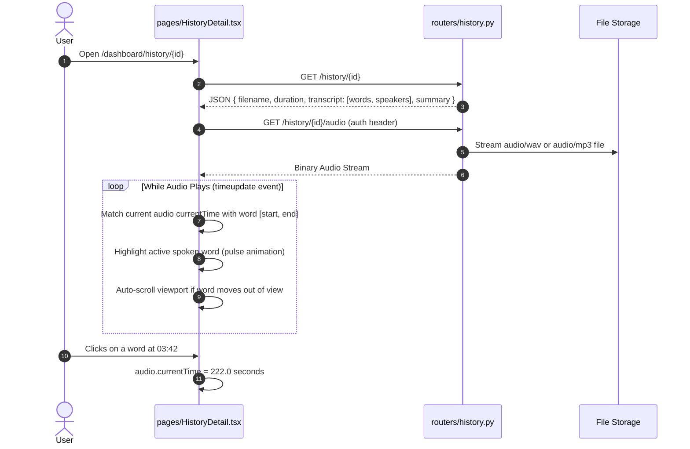

# Recording Sessions, History & Synchronized Transcript Player

## 1. Overview & Architectural Role

The **History & Player** subsystem manages the persistence, retrieval, synchronized playback, and interactive editing of all recorded or uploaded audio meetings. It serves as the primary post-meeting workspace for reviewing speech transcriptions, playing audio with word-level highlight tracking, reassigning speakers, and exporting formal meeting documents.

---

## 2. History Listing & Filtering Architecture

### 2.1 Backend Route (`backend/routers/history.py`)
The endpoint `GET /history` returns all active recordings for the authenticated user:
```sql
SELECT id, filename, duration, status, speakers_detected, summary, created_at, processed_at
FROM recordings
WHERE user_id = :uid
ORDER BY created_at DESC
LIMIT 100;
```

### 2.2 Strict Audio Record Separation
To maintain a clean separation between **Audio/Video Meetings** and **Pure Text Documents**:
- Audio meetings (which have recorded speech, duration, and audio files on disk) are listed in History.
- Textual Manual MoMs uploaded in AI Chat are stored exclusively in the `manual_moms` table and are excluded from the `recordings` table.
- This ensures that every item in History can be played with real audio and viewed with a synchronized transcript timeline.

---

## 3. Synchronized Transcript Audio Player (`pages/HistoryDetail.tsx`)

The detail viewer integrates an interactive HTML5 audio player directly with the word-level transcript:



---

## 4. Key Endpoints & Features

| Endpoint | Method | Purpose |
|---|---|---|
| `/history` | `GET` | List all historical recordings for user. |
| `/history/{id}` | `GET` | Retrieve full recording details, transcript words, and speaker maps. |
| `/history/{id}/audio` | `GET` | Authenticated audio streaming with `Range` header support. |
| `/history/{id}/rename` | `PATCH` | Rename recording title or filename. |
| `/history/{id}` | `DELETE` | Delete recording row, disk files, and collection links. |
| `/history/{id}/transcript` | `PATCH` | Edit a specific transcript segment's text or speaker. |
| `/history/{id}/correct-mistake`| `POST` | AI-assisted phonetic and spelling mistake correction. |
| `/history/{id}/reidentify-speakers`| `POST`| Re-run ECAPA2 matching against newly added voice profiles. |
| `/history/{id}/regenerate-insights`| `POST`| Re-generate short/detailed summaries and key points. |

---

## 5. Speaker Reassignment & Interactive Editing

Users can correct misattributed speakers or transcription errors directly in the UI:
1. **Single Segment Edit:** Double-clicking any segment in `HistoryDetail.tsx` opens an inline editor. Submitting triggers `PATCH /history/{recording_id}/transcript` to update both the word array and full raw text.
2. **Global Speaker Reassignment:**
   - Clicking a speaker's name allows renaming them (e.g. `SPEAKER_01` $\rightarrow$ `Alice Johnson`).
   - The frontend calls `speaker_sync.py` to update the mapping across all occurrences in the meeting and save a permanent alias in `speaker_mappings`.

---

## 6. Collections & Multi-Meeting Grouping

The History page features an embedded **Collections Panel** (`components/collections/CollectionsPanel.tsx`):
- Users can create custom collections (e.g., `"Project Apollo"`, `"Sprint Retrospectives"`, `"Board Meetings"`).
- Meetings can be organized into collections via drag-and-drop or batch selection dialogs (`AddMeetingsDialog.tsx`).
- Under `/collections/{id}/ai`, users can execute multi-meeting cross-analysis, topic trajectory tracking, and comparative synthesis across all meetings in that collection.
