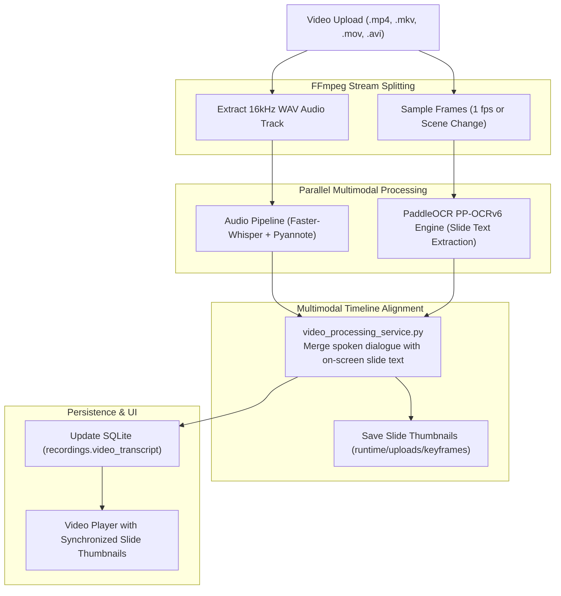

# Video Meeting Processing & Visual Slide Analysis

## 1. Overview & Purpose

Many enterprise meetings take place over video conferencing (Zoom, Teams, Google Meet, Webex) where presentation slides, software demonstrations, architectural diagrams, and financial spreadsheets are shared on screen.

The **Video Meeting Analysis** subsystem processes both the **auditory** and **visual** tracks of a video file simultaneously:
1. **Audio Track**: Transcribed and diarized into speaker-attributed dialogue.
2. **Visual Video Track**: Sampled for slide transitions and keyframes, with on-screen text extracted via offline **PaddleOCR PP-OCRv6**.
3. **Unified Multimodal Timeline**: Synchronizes what was shown on screen with what was being spoken at that exact moment.

---

## 2. Video Processing Pipeline Architecture



---

## 3. Visual Text Extraction & Scene Detection

### 3.1 Scene Detection
- **Location:** [`backend/services/video_processing_service.py`](file:///e:/projects/Transcriber-meeting-initial/backend/services/video_processing_service.py)
- **Algorithm:** Uses FFmpeg scene change filter (`select='gt(scene,0.3)'`) or fixed interval sampling (e.g., every 5 seconds) to identify slide transitions without processing thousands of redundant static frames.

### 3.2 Offline Optical Character Recognition (PP-OCRv6)
- **Location:** [`backend/services/ocr_engine.py`](file:///e:/projects/Transcriber-meeting-initial/backend/services/ocr_engine.py)
- **Models:** Runs offline models stored in `Application/runtime/ocr_models/`.
- Extracts:
  - Slide titles and bullet points.
  - Numbers, tables, and architectural diagram labels.
  - Generates an entry with `{timestamp, frame_path, slide_title, slide_text}`.

---

## 4. Merged Video Transcript Structure

The resulting `video_transcript` column in `recordings` stores an enriched timeline:
```json
[
  {
    "type": "slide_change",
    "timestamp": 145.0,
    "slide_index": 3,
    "thumbnail_url": "/video/keyframes/rec_123_slide3.jpg",
    "ocr_text": "Q3 Operational Goals: 1. Deploy 100 on-prem clusters. 2. Finalize SOC2 compliance."
  },
  {
    "type": "spoken_turn",
    "speaker": "Alice Chen",
    "start": 146.2,
    "end": 168.0,
    "text": "As you can see on slide three, our primary objective this quarter is delivering on our on-prem deployment."
  }
]
```

---

## 5. Key Endpoints (`backend/routers/video_router.py`)

- **`POST /video/upload`**: Ingests video file, extracts audio, registers pipeline job.
- **`GET /video/jobs/{recording_id}/video-transcript`**: Retrieves the synchronized slide-plus-speech transcript.
- **`GET /video/jobs/{recording_id}/keyframes/{filename}`**: Serves keyframe slide thumbnail images.
- **`POST /video/jobs/{recording_id}/rerun-ocr`**: Allows re-running OCR with adjusted sensitivity thresholds without re-transcribing the audio.
