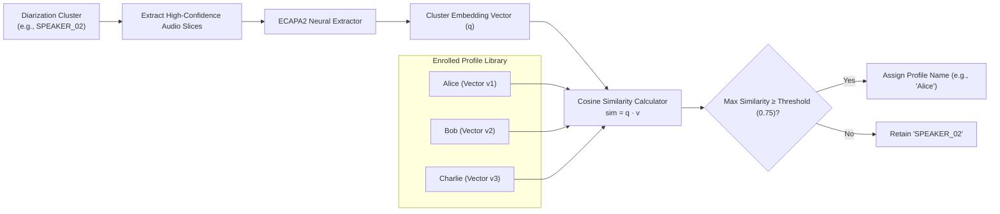

# Speaker Management, Voice Profiles & Global Synchronization

## 1. Overview & Architectural Role

The **Speaker Management & Voice Profile** subsystem eliminates generic, anonymous labels (`SPEAKER_00`, `SPEAKER_01`) by building a persistent, organizational **Voice Print Library**. Once a user enrolls their voice (or is labeled in a meeting), VoiceSum recognizes them across all future meetings automatically.

---

## 2. Voice Enrollment & Embedding Extraction

### 2.1 Acoustic Model
- **Model:** `speechbrain/spkrec-ecapa-voxceleb` (ECAPA2 TDNN architecture).
- **Embedding Size:** 192 or 512 dimensions float32.
- **Normalization:** Embeddings are centered and $L_2$-normalized.

### 2.2 Profile Creation (`services/voice_profile_service.py`)
Users can enroll voice signatures via:
1. **Direct Audio Upload / Microphone Recording:** User reads a short sample script (15–30 seconds) on the Voice Profiles page.
2. **One-Click Enrollment from History:** When a user renames `SPEAKER_00` to `"David Kim"` in a meeting transcript, clicking *Enroll Voice* extracts all clean audio slices spoken by that person and registers a new profile automatically.

### 2.3 Centroid Vector Averaging
When multiple audio samples are provided for a single person:
1. Embeddings are extracted for each sample: $\{e_1, e_2, \dots, e_N\}$.
2. Outliers with low internal cosine similarity are discarded.
3. The remaining embeddings are averaged to form the profile **centroid** $\bar{e}$:
   $$\bar{e} = \frac{\sum_{i=1}^N e_i}{\left\|\sum_{i=1}^N e_i\right\|_2}$$
4. The centroid is serialized as a binary blob or JSON array in the SQLite `speaker_profiles` table.

---

## 3. Identification & Matching Logic (`services/identification.py`)

During meeting processing, every detected cluster from Pyannote is compared against all enrolled profiles:

---

## 4. Global Speaker Synchronization (`services/speaker_sync.py`)

When a speaker's name or title is updated:
- **Local Propagation:** Updates all segments within the active recording.
- **Global Synchronization:** If enabled (`speaker_sync_global=1`), searches previous meeting transcripts in the database for matching voice embeddings and updates legacy labels consistently across the user's meeting history.
- **Scoped Matching:** Settings option `restrict_reassignment_to_meeting_speakers` restricts speaker assignment exclusively to enrolled participants of that specific scheduled calendar event.

---

## 5. Key Endpoints (`backend/routers/voice.py` & `speaker_management_router.py`)

- **`POST /voice/profiles`**: Create new voice profile with name, role, email, and audio samples.
- **`GET /voice/profiles`**: List all enrolled speaker profiles with sample counts and metadata.
- **`POST /voice/profiles/{id}/samples`**: Add additional training audio samples to strengthen an existing profile centroid.
- **`DELETE /voice/profiles/{id}`**: Delete a voice profile and remove associated vectors.
- **`POST /speaker-management/sync`**: Batch-synchronize speaker names across historical meeting transcripts.
